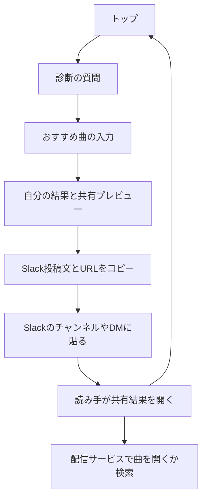

# MACHA-TUNE 基本設計書

初回リリース案 v0.5 ／ 2026年11月22日  
参照資料　MACHA TUNE 企画書 v0.4

## 1. 対象範囲

ひとりで音楽タイプを診断し、本人が選んだ1曲または3曲と一緒にSlackで共有する。読み手は共有URLから結果を開き、Spotify・Apple Music・YouTube Musicのうち普段使うサービスで曲を探せる。診断・閲覧ともにアカウント不要とする案。ユーザー間の紐づけ、友達追加、診断結果の比較、相性スコアは初回の対象外。

## 2. 画面遷移

質問と曲入力では「戻る」で編集できる。共有プレビューからも入力へ戻れる。公開済みのページは発行時点の内容を表示し、診断の入力を編集しても内容が途中で切り替わらない。

## 3. 画面仕様

| 画面 | 表示する内容 | 主な操作と状態 |
| --- | --- | --- |
| トップ | MACHA-TUNE、新しい「好きな曲」と出会う、診断と曲のシェアの説明 | 「診断をはじめる」 |
| 診断の質問 | 1画面に1問、選択肢、進捗（例「2 / 6」） | 1つ選んで「次へ」。未選択なら案内を表示。戻っても回答を維持 |
| おすすめ曲の入力 | 自分のおすすめ履歴ツリー、5つのテーマと入力例、曲名、アーティスト名、任意の配信リンク | 最初に1曲か3曲かを選ぶ。1曲なら1テーマ、3曲なら異なる3テーマを選び、各テーマに1曲ずつ入力する。切り替え時は掲載するお題を確認し、ほかの入力は下書きに残す。配信リンク欄は折りたたんで表示。エラーは対象の入力欄の近くに表示 |
| 自分の結果と共有プレビュー | タイプ名、判定理由、選んだ曲数分の曲カード、任意の表示名、読み手に見える内容 | 「Slack用の投稿文をコピー」で共有URLを発行。成功時は貼り付け案内を表示。クリップボードが使えない場合は選択できる投稿文を表示 |
| 共有結果 | タイプ名、判定理由、任意の表示名、選んだ曲数分の曲カード、各サービスへのリンク | ログインせずに閲覧。外部リンクから戻って次の曲を選べる。「自分も診断する」から新規診断へ |
| 共有結果が見られない画面 | 「この共有ページは表示できません」 | トップへ戻る。無効・期限切れ・取り消し済みで共通の案内を使う |

スマートフォンでは1カラム。共有結果はタイプ名と最初の曲を上から読める順に置く。ブランドカラーはターコイズ（#22DCC7）と白（#FFFFFF）。本文とボタンの文字は濃い色にし、押せる場所や入力エラーは文言でも伝える。

## 4. 入力と診断

| 項目 | 初回案 |
| --- | --- |
| 診断の回答 | 6問、各1つ選択。質問と選択肢には固定IDを付ける |
| 曲のお題 | 「ここ最近で一番アツい曲」「元気を出したいとき」「落ち着きたいとき」「つい歌いたくなるとき」「ずっと好きな曲」の5つ |
| 曲名・アーティスト名 | 各曲で必須。前後の空白を取り除き、空欄をチェックする。各100文字まで |
| 配信リンク | 曲ごと・サービスごとに任意。直接開くリンクとして使うサービスのHTTPS URLのみ受け付ける |
| 表示名 | 任意。前後の空白を取り除き、30文字まで。空欄なら共有ページに名前欄を出さない |

診断タイプは仮に「歌詞」「メロディー」「リズム」「曲の雰囲気」の4系統。選択肢ごとに1タイプに1点を加え、合計が最も高いものを結果にする。同点なら「曲のどこに最初に惹かれるか」の回答が示すタイプを優先し、そのタイプが同点候補にない場合は定義した順序で決める。結果の説明にはタイプの特徴と、実際に選んだ回答のうち判定を裏づけるものを一つ添える。質問文・配点表・タイプ名は詳細設計で確定する。

## 5. 共有と配信リンク

- **公開するタイミング**　本人の確認後、共有操作が実行された時点で公開する。画面に「URLを知っている人が閲覧できます」と表示する。URLには推測しにくいランダムなIDを使う。
- **公開する内容**　表示名（任意）、タイプ名と説明、お題と曲名・アーティスト名、配信用リンク。質問ごとの回答は共有ページに表示せず、共有用データにも保存しない。
- **Slack投稿文**　「音楽タイプを診断してみたら『歌詞から好きになるタイプ』だった。おすすめ曲も載せたよ。」に閲覧URLを添える。Slackへの貼り付けと送信は本人が行う。リンクプレビューの文言はサービスの説明を使う。
- **再試行**　発行中はボタンを無効にする。通信失敗時は入力を保持し、再試行を案内する。同じ共有操作の再試行には同じ発行キーを使う。コピーだけ失敗した場合は、発行済みURLを使って投稿文を表示する。
- **配信サービス**　曲URLがある場合は「Spotifyで開く」のように表示する。ない場合は「Spotifyで検索」のように、曲名とアーティスト名を使った検索へ送る。配信先のURL形式と、各サービスの検索から曲にたどり着けることは実装前に実機で確認する。サービス側のログインや再生条件は外部遷移先に従う。
- **有効期間と取り消し**　初回案では作成から30日で閲覧不可とし、保存した共有データを期限経過後に削除する。発行者には閲覧URLとは別の管理用URLを案内し、そこから取り消せるようにする。管理用URLはSlack投稿文に含めない。

## 6. 保存するデータ

| データ | 主な項目 | 保存先と用途 |
| --- | --- | --- |
| 診断の定義 | バージョン、質問、選択肢、配点、タイプ説明、お題 | アプリ内で管理し、判定時に参照 |
| 入力途中のデータ | 回答、選んだ曲数とお題、曲の下書き、表示名、現在の画面 | 同じブラウザのタブ内で保持。入力画面に戻った場合に復元 |
| 共有結果 | 公開ID、タイプ名、判定理由、表示名（任意）、作成日時、期限、公開状態、管理トークンのハッシュ、発行キー | サーバーに保存。共有ページの表示と取り消しに使う |
| 共有結果の曲 | 公開IDに紐づくお題、表示順、曲名、アーティスト名、配信URL（任意） | 共有結果と一緒に保存。表示順はお題順で固定 |

診断から結果プレビューまではブラウザ側で処理する。共有時にサーバーでも入力を検証し、回答から判定結果を再計算して、選んだ曲数が1または3で掲載対象の曲数と一致することを確認し、公開用データと掲載対象の曲だけを一括保存する。フレームワーク、データベース、ホスティングは、必要な機能を洗い出したあとに決める。

## 7. 動作確認の基準

1. スマートフォンで診断に回答し、前の質問に戻っても回答を確認できる。
2. 配信リンクを入力せずに1曲・3曲の各パターンで登録し、判定理由と選んだ曲数分の曲カードを確認できる。
3. プレビューした内容を共有でき、Slackに貼ったURLを別のブラウザで開いて同じ結果を閲覧できる。
4. 曲URLがある場合は曲ページが開き、空欄の場合は選んだサービスの検索に進める。
5. コピー不可・通信失敗の状態から、入力を失わず共有操作を続けられる。
6. 無効・期限切れ・取り消し済みのURLから共有結果を閲覧できない。

## 8. 次の設計で確定すること

- **質問と結果の中身**　6問の質問、選択肢と配点、4タイプの名前と結果文。実際に答えて、結果をSlackに載せたいと思えるか試す。
- **曲カードの操作**　サービス選択ボタンの配置、曲リンク入力欄の見せ方、スマートフォンで外部サービスを開いて戻る動き。
- **共有データの運用**　30日という期限、取り消し操作、保存と削除の方法、Slack上のリンクプレビュー。

## 9. 曲の登録画面の履歴ツリー

おすすめ曲の登録画面にだけ、ログイン不要の個人用履歴を表示する。共有リンクを発行した過去の曲を1曲ずつ縦線でつなぎ、上に新しい曲、下に古い曲を置く。各項目には曲名、アーティスト名、選んだテーマ、リンク作成日を表示する。日付は本人がSlackに投稿した日時とは区別する。

| 履歴の曲数 | 登録画面での動き |
| --- | --- |
| 0曲 | 履歴欄を省き、すぐ曲を入力できる |
| 1〜2曲 | すべて表示する |
| 3曲以上 | 最新2曲を表示。「過去に共有した曲を表示する」を押すと、その下に残りの全曲を展開する。「閉じる」で最新2曲に戻す |

展開と折りたたみは同じ画面内で行い、入力中の曲や選択したテーマを保持する。3曲で共有した記録は3項目として数える。共有ページとトップ・結果画面にはツリーを出さない。履歴は同じ端末・ブラウザに保存し、端末間の同期は行わない。

完了した診断の結果は従来どおり端末に保存し、初めて共有URLが発行されたときに発行日時と共有IDを追記する。ツリーには発行済みの記録だけを使う。発行日時の降順、同じ共有内では曲の掲載順で並べ、再コピーや再読み込みでは項目を増やさない。以前の保存済み記録も同じ規則で扱う。共有URLが期限切れになっても端末の履歴は残る。履歴の個別削除と公開リンクの取り消しを区別する。保存できないときも曲の登録を続けられる。サイトデータ消去で端末履歴が失われることを案内する。

受け入れ確認では0・1・2・3曲以上の各状態を試す。3曲の共有を1回行って登録画面に戻り、2曲から全3曲に展開できること、入力途中で開閉しても入力が残ること、別の閲覧者が共有URLを開いてもツリーが表示されないことを確認する。
